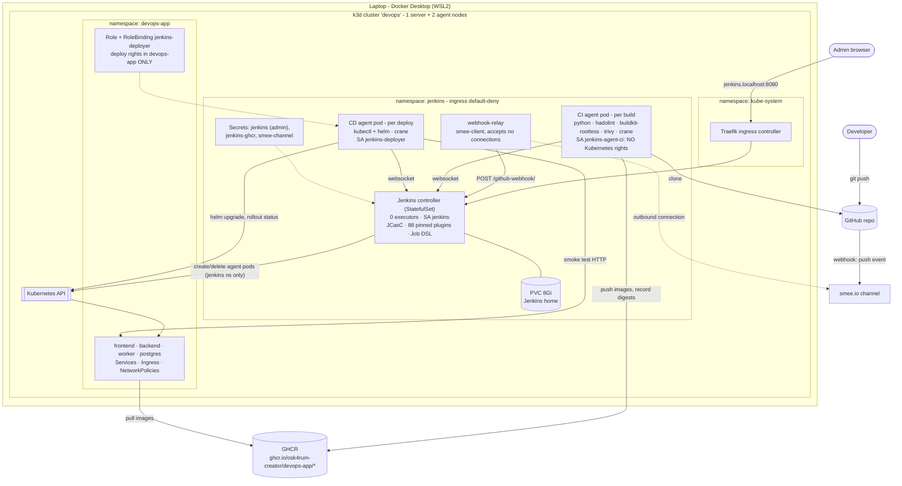

# DevOps on AWS – Rolling Project

A small three-service app (web frontend, API backend, background worker) with
PostgreSQL, S3 and SNS, run on **Kubernetes** with a **Helm chart**
(Task 3) and built and deployed by **Jenkins CI/CD** (Task 4, added below).

| Task | Status | Where |
|---|---|---|
| 1 – App on EC2 | Submitted | – |
| 2 – Terraform + Ansible | Submitted | [`task2-archive/`](task2-archive/) |
| **3 – Kubernetes** | **This README** | `app/`, `helm/`, `k8s/`, `scripts/`, `evidence/task3/` |
| **4 – Jenkins CI/CD** | **Section 12** | `jenkins/`, `Jenkinsfile-ci`, `Jenkinsfile-cd`, `evidence/task4/` |

---

## 1. What the app does

| Component | Technology | Role |
|---|---|---|
| **frontend** | nginx (unprivileged) | The **only** public entry point. Serves the web page and forwards `/api/*` to the backend |
| **backend** | Python Flask + gunicorn | REST API: saves and lists notes in PostgreSQL, uploads files to S3 |
| **worker** | Python | Background loop: every 10 s finds new uploads in the DB and sends an SNS email |
| **postgres** | PostgreSQL 17 | Stores notes and upload records |
| S3 / SNS | AWS (outside the cluster) | File storage and email notifications |

Flow for an upload: `browser → frontend → backend → S3 + DB row → worker sees row → SNS email`.

## 2. Architecture


**Public / internal:** only the Ingress is reachable from outside. All four
Services are `ClusterIP` (internal). The worker has **no Service at all**,
because nothing ever connects to it. Every arrow in the diagram is an
allowed connection; everything else is blocked by NetworkPolicies (section 7.4).

### Inside the cluster vs. outside

| Inside Kubernetes | Outside the cluster |
|---|---|
| frontend, backend, worker, PostgreSQL, Ingress, ConfigMap, Secrets, NetworkPolicies, ServiceAccounts | S3 bucket, SNS topic, IAM user (AWS, created by Terraform in [`terraform/`](terraform/)) |

### Why a local cluster (k3d) instead of EKS
The task allows k3d/kind. EKS would cost roughly $9/day (control plane, nodes,
NAT gateway, load balancer) and the AWS account has no budget left. k3d runs a
real multi-node Kubernetes (k3s) inside Docker, ships an ingress controller
(Traefik), and **enforces NetworkPolicies**. The same Helm chart would run on
EKS by changing values (see Trade-offs).

## 3. Repository layout

```
app/{frontend,backend,worker}/   source code, Dockerfile, .dockerignore per service
helm/devops-app/                 Helm chart: templates/ + values.yaml
k8s/secret.example.yaml          format of the secrets (fake values only)
terraform/                       S3 bucket, SNS topic, least-privilege IAM user
scripts/                         create / deploy / test / scan / evidence / destroy
evidence/task3/                  command outputs proving everything works
task2-archive/                   Task 2, kept for reference
```

### The Helm chart

| Template | Creates |
|---|---|
| `frontend.yaml`, `backend.yaml` | Deployment + ClusterIP Service each |
| `worker.yaml` | Deployment only (no Service) |
| `postgres.yaml` | StatefulSet + PersistentVolumeClaim + Service (toggle: `postgres.enabled`) |
| `configmap.yaml` | `app-config`: non-sensitive settings from `values.yaml` |
| `serviceaccounts.yaml` | One ServiceAccount per component, API token not mounted |
| `ingress.yaml` | Route from the ingress controller to the frontend only |
| `networkpolicies.yaml` | Default-deny + one allow-policy per component |
| `_helpers.tpl` | Shared labels and the image name, so they aren't repeated |

Every Deployment defines: image, replicas, labels, selector, ports, env vars
(ConfigMap + Secrets), resource requests/limits, readiness and liveness probes,
and a restrictive securityContext.

## 4. Prerequisites

| Tool | Version used | Install (Windows, Chocolatey) |
|---|---|---|
| Docker Desktop (WSL2) | 4.96 / engine 29.9 | `choco install docker-desktop` |
| k3d | 5.9.0 (Kubernetes 1.35) | `choco install k3d` |
| kubectl | 1.37 | `choco install kubernetes-cli` |
| Helm | 4.1 | `choco install kubernetes-helm` |
| Trivy | 0.76 | `choco install trivy` |
| Git Bash | – | comes with Git for Windows; **run all scripts in Git Bash** |

## 5. How to run it

```bash
# 1. Create the cluster (1 server + 2 agents, host port 8080 -> ingress)
./scripts/create-cluster.sh

# 2. Commit your code - images are tagged with the commit SHA
git add . && git commit -m "..."

# 3. Build, load, create namespace + secrets, install the chart
./scripts/deploy-local.sh

# 4. Open the app
http://localhost:8080
```

What `deploy-local.sh` does, step by step:

| Step | Command (simplified) | Why |
|---|---|---|
| Tag | `TAG=$(git rev-parse --short HEAD)` | Every image is traceable to exact code; never `latest` |
| Build | `docker build -t devops-app/<svc>:$TAG app/<svc>` | One image per service |
| "Push" | `k3d image import ...` | A local cluster can load images directly instead of pulling from a registry. Task 4 pushes to a real registry (GHCR) |
| Namespace | `kubectl create namespace devops-app` | The app never runs in `default` |
| Secrets | `kubectl create secret generic db-credentials --from-env-file=secrets/db.env` | Values come from gitignored files; a random DB password is generated on first run |
| Deploy | `helm upgrade --install devops-app helm/devops-app -n devops-app --set image.tag=$TAG --wait` | Installs or upgrades in one idempotent command; `--wait` fails if pods don't become ready |

### Creating the secrets manually
The format is in [`k8s/secret.example.yaml`](k8s/secret.example.yaml) (fake values).

```bash
mkdir -p secrets            # gitignored
printf 'DB_USER=app\nDB_PASSWORD=<strong-password>\n' > secrets/db.env
kubectl create secret generic db-credentials -n devops-app --from-env-file=secrets/db.env

# optional - enables S3 + SNS (keys of the IAM user from terraform/)
printf 'AWS_ACCESS_KEY_ID=...\nAWS_SECRET_ACCESS_KEY=...\n' > secrets/aws.env
kubectl create secret generic aws-credentials -n devops-app --from-env-file=secrets/aws.env
```

## 6. How to check that it works

```bash
./scripts/collect-evidence.sh        # regenerates everything in evidence/task3/
./scripts/test-network-policies.sh   # 15 allowed/blocked connection tests
./scripts/scan-images.sh             # Trivy vulnerability scan of all images
```

| Evidence file | Shows |
|---|---|
| [`01-cluster-and-workloads.txt`](evidence/task3/01-cluster-and-workloads.txt) | All `kubectl get` outputs required by the task |
| [`02-describe-pods.txt`](evidence/task3/02-describe-pods.txt), [`03-logs.txt`](evidence/task3/03-logs.txt) | `describe` and `logs` of every component |
| [`04-app-tests.txt`](evidence/task3/04-app-tests.txt) | HTTP through the Ingress, frontend → backend, DB write + read, worker processing an upload |
| [`05-self-healing.txt`](evidence/task3/05-self-healing.txt) | Pods deleted and replaced, app keeps working, data survives a DB restart |
| [`06-security-checks.txt`](evidence/task3/06-security-checks.txt) | Non-root users, read-only filesystem, no API token, dropped capabilities, pinned image tags |
| [`network-policy-tests.txt`](evidence/task3/network-policy-tests.txt) (+ `-BEFORE`) | 15/15 tests pass; before the policies, 7 should-be-blocked connections were open |
| [`image-scans/SUMMARY.md`](evidence/task3/image-scans/SUMMARY.md) | CRITICAL vulnerabilities 18 → 1 (accepted with reasoning) |

## 7. Security

### 7.1 Separation of permissions (ServiceAccounts)
Each component has **its own ServiceAccount** (`frontend`, `backend`, `worker`,
`postgres`) instead of sharing `default`. None of the apps talks to the
Kubernetes API, so:
- **No RBAC Roles or RoleBindings are granted** to any app ServiceAccount – zero
  Kubernetes permissions. No `cluster-admin` anywhere.
- `automountServiceAccountToken: false` – the API token isn't even placed in the pods,
  so a compromised container has no credential to talk to the cluster.

Why not one broad account for everything: if a single component is compromised,
the attacker gets only that component's permissions. With shared, broad
permissions, one weak service exposes the whole system.

AWS permissions are also separate from Kubernetes permissions: only backend and
worker receive the `aws-credentials` Secret; the frontend and Postgres never see it.

### 7.2 RBAC
Not needed for the app (no component calls the Kubernetes API). Task 4 adds
RBAC for Jenkins with minimal, namespace-scoped Roles.

### 7.3 Secrets management
| Question | Answer |
|---|---|
| Where are secrets stored? | In **Kubernetes Secrets** inside the cluster, created from local files in `secrets/` (gitignored) |
| How are they created? | `deploy-local.sh` (generates a random DB password on first run) or the manual commands in section 5 |
| What is in Git? | Only `k8s/secret.example.yaml` with fake values. `.gitignore` also blocks `*.tfstate`, `*.pem`, `.env` |
| What is NOT a secret? | DB host, bucket name, topic ARN, region → ConfigMap `app-config` |
| Only Kubernetes Secrets? | Yes. Limitation: Secrets are base64-encoded, not encrypted, and anyone with read access to Secrets in the namespace can read them. Production improvement: External Secrets Operator + AWS Secrets Manager, or Sealed Secrets, plus etcd encryption at rest |

The AWS access key for S3/SNS is deliberately **not created by Terraform** –
Terraform would store it in plain text in `terraform.tfstate`. It is created with
`aws iam create-access-key` and goes straight into `secrets/aws.env`.

### 7.4 Network security
All pods in `devops-app` start from **default deny** (no traffic in or out).
Allow rules are added per component – a connection works only if a rule allows it.

| From → To | Allowed? | Why |
|---|---|---|
| Internet → Ingress → **frontend** :8080 | ✅ | The single public entry point (only Traefik pods may reach the frontend) |
| frontend → **backend** :8000 | ✅ | nginx forwards `/api` |
| backend, worker → **postgres** :5432 | ✅ | They read/write data |
| backend, worker → internet :443 | ✅ | AWS S3/SNS APIs (HTTPS only, private IP ranges excluded) |
| all pods → CoreDNS :53 | ✅ | Name lookup (`backend`, `postgres`) |
| anything → **worker** | ❌ | The worker accepts no connections at all |
| frontend → postgres | ❌ | The frontend never needs the DB; limits damage if nginx is compromised |
| worker → backend | ❌ | Not needed |
| postgres → anywhere | ❌ | The database never initiates connections |
| pods in other namespaces → any app pod | ❌ | Only the ingress controller may enter |

Exposed outside the cluster: **only the Ingress → frontend**. backend, worker
and postgres have no route from outside. Proof: [`network-policy-tests.txt`](evidence/task3/network-policy-tests.txt).

> **Why this matters:**
> Default deny and blocking frontend → database matter because they create a dead end
> for any hacker: even if they get access to the frontend, they can't crawl into the database.

### 7.5 Container security
Set in every pod (verified in [`06-security-checks.txt`](evidence/task3/06-security-checks.txt)):

```yaml
securityContext:              # pod level
  runAsNonRoot: true
  runAsUser: 10001            # 101 for nginx, 70 for postgres
  seccompProfile: { type: RuntimeDefault }
containers:
  - securityContext:          # container level
      allowPrivilegeEscalation: false
      readOnlyRootFilesystem: true
      capabilities: { drop: ["ALL"] }
```

Writable paths are explicit `emptyDir` volumes only (`/tmp`, nginx's generated
config, Postgres' socket dir) – an attacker can't modify the app or drop files
elsewhere. Every container has CPU/memory **requests and limits**, so one
component can't starve the others.

### 7.6 Image security
| Question | Answer |
|---|---|
| Where do images come from? | Built from our own Dockerfiles in `app/`, on top of official base images (`python`, `nginxinc/nginx-unprivileged`, `postgres`) |
| Fixed tags, no `latest`? | Base images pinned to exact versions; our images tagged with the **git commit SHA** |
| Secrets in images? | None – all config comes from env vars at runtime; `.dockerignore` excludes `.env` and caches |
| Non-root? | Every Dockerfile ends with a non-root `USER` |
| Scanned? | Yes, Trivy ([`image-scans/SUMMARY.md`](evidence/task3/image-scans/SUMMARY.md)): first scan found 18 CRITICAL / 335 HIGH in old base images → updated to patched versions → **1 CRITICAL** left (in an image helper that never runs, see summary). Python dependencies: 0 HIGH/CRITICAL |

### 7.7 Ingress security
| Question | Answer |
|---|---|
| How is the app exposed? | k3d load balancer (host port 8080) → Traefik ingress controller → Ingress `frontend` → frontend Service |
| HTTPS? | Not locally (localhost only, no domain). On EKS: AWS Load Balancer Controller with an ACM certificate, or cert-manager + Let's Encrypt, with HTTP → HTTPS redirect |
| Access restriction? | Only the frontend has a route; the cluster is reachable only from this machine. On a public cloud: source-IP allowlist on the load balancer or a WAF |
| Public vs internal traffic separated? | Yes – public traffic enters only through the Ingress; all Services are internal `ClusterIP`; NetworkPolicies allow the frontend to receive traffic only from the ingress controller |

## 8. AWS: S3 and SNS (blocked)

[`terraform/`](terraform/) creates a private, encrypted **S3 bucket**, an **SNS
topic with email subscription**, and an **IAM user** whose policy allows only
`s3:PutObject`/`s3:GetObject` on `uploads/*` and `sns:Publish` on that one topic.

**Status:** the code is complete and validated (`terraform validate`), but
`terraform apply` is blocked – the AWS account was closed by AWS after the free
credits ran out (outstanding balance under review with AWS billing support).
Until then the app runs with S3/SNS disabled: uploads return a clear
`S3 is not configured` error and the worker logs the email it *would* send
(see [`04-app-tests.txt`](evidence/task3/04-app-tests.txt)). Enabling it needs no
code changes:

```bash
cd terraform && cp terraform.tfvars.example terraform.tfvars   # set alert_email
terraform init && terraform plan && terraform apply
aws iam create-access-key --user-name devops-app-local          # -> secrets/aws.env
# put terraform outputs into helm/devops-app/values.yaml (S3_BUCKET, SNS_TOPIC_ARN)
./scripts/deploy-local.sh
```

**Why an IAM user and not IRSA:** IRSA (IAM Roles for Service Accounts) needs
EKS – AWS trusts the cluster's identity provider and gives each ServiceAccount a
short-lived role. A local cluster has no such trust, so a static access key is
the only option. Disadvantages: the key doesn't expire, must be rotated
manually, and anyone who reads the Secret can use it. Mitigations: the policy
is limited to two actions on two resources, and only backend/worker get it.
On EKS, `backend` and `worker` ServiceAccounts would get separate IRSA roles
and the Secret would disappear.

### Database connection (RDS question in the task)
| Question | Answer |
|---|---|
| Where does the endpoint come from? | `DB_HOST=postgres` in the ConfigMap – the Kubernetes Service name of the in-cluster database |
| How are username/password stored? | Secret `db-credentials` (see 7.3), read by backend, worker and postgres |
| Who may connect? | Only backend and worker pods (NetworkPolicy `postgres`) |
| What restricts access? | NetworkPolicies (the in-cluster equivalent of the Security Groups used for RDS in Task 2) |
| Why not RDS? | Practice setup without AWS budget. In production RDS is better: managed backups, Multi-AZ failover, patching, no container image to maintain. Switching = `postgres.enabled=false` + RDS endpoint in `DB_HOST` + RDS security group allowing the node group |

## 9. Deleting the environment

```bash
./scripts/destroy-local.sh             # remove app, namespace, secrets and DB data
./scripts/destroy-local.sh --cluster   # ...and delete the k3d cluster
cd terraform && terraform destroy      # AWS resources (when the account is active)
```

## 10. Trade-offs and decisions

| Decision | Why | Cost / what production would do |
|---|---|---|
| k3d instead of EKS | Free, real Kubernetes, allowed by the task | No IRSA, no AWS load balancer; same chart would run on EKS with different values |
| PostgreSQL in the cluster | No AWS budget; allowed for practice | RDS: backups, failover, patching |
| Static IAM key for S3/SNS | IRSA impossible outside EKS | Key rotation is manual; IRSA on EKS |
| Kubernetes Secrets only | Simple, no extra components | External Secrets Operator + AWS Secrets Manager |
| HTTP only | Localhost, no domain | TLS via ACM or cert-manager |
| `k3d image import` instead of a registry | No registry needed locally | Task 4 pushes to GHCR |
| Helm instead of plain manifests | One chart for every environment; required by Task 4's CD | Slightly more to learn than plain YAML |
| Schema created by the backend on startup | Simple for a small app | A migration tool (e.g. Alembic) as a separate Job |

## 11. Problems found and fixed

| Problem | Cause | Fix |
|---|---|---|
| Frontend pod in `CrashLoopBackOff` after a cluster restart | nginx resolved `backend` only once at startup, before cluster DNS was ready | nginx now resolves the name per request (`resolver` + variable); reproduced by switching DNS off – nginx now starts and recovers by itself |
| `kubectl` showed "No resources found" | Docker Desktop's built-in Kubernetes switched the active context | `kubectl config use-context k3d-devops`; disabled Docker Desktop Kubernetes |
| Network test reported a false pass | Test pod from the previous run was still being deleted, so "blocked" really meant "pod missing" | Script waits for cleanup and adds a control check that the test pod is alive |
| Scan script stopped on a clean image | `grep` returns an error code when nothing matches, and `set -e` aborted | `grep -c ... \|\| true` |
| 18 CRITICAL vulnerabilities | Base images pinned a year earlier | Updated to the latest patch versions of the same release lines |
| Scripts could break on Linux | Windows line endings (CRLF) | `.gitattributes` forces LF |

> **Most useful lesson:**
> I learned that the order things start in matters. After the cluster restarted, the
> frontend crashed because it started before DNS was ready and couldn't find the backend.
> Making nginx look up the backend on every request fixed it, so now the frontend
> recovers by itself.

---

# Task 4 – CI/CD with Jenkins inside Kubernetes

## 12.1 Architecture and choices

| Decision | Choice | Why |
|---|---|---|
| Cluster | **On-premise (local) multi-node cluster**: the same k3d cluster as the app (1 server + 2 agents) | Allowed by the task; no AWS budget. Same Kubernetes API as EKS |
| Jenkins location | **Same cluster**, own namespace `jenkins`; app stays in `devops-app` | One cluster to run locally. Separation is done with namespaces, RBAC and NetworkPolicies instead of separate clusters |
| How CD authenticates to the cluster | The CD agent pod runs as ServiceAccount **`jenkins-deployer`**; Kubernetes mounts its short-lived token automatically | No kubeconfig file or static credential anywhere. Its Role only works inside `devops-app` |
| Installation | Official Helm chart `jenkins/jenkins` **5.10.2** (Jenkins **2.580.2 LTS**) + **JCasC** + **Job DSL** | Everything is code: a clean install recreates the same Jenkins, credentials, agent templates and jobs |
| Agents | Pods created per build and deleted afterwards (`podRetention: Never`); controller has **0 executors** | Builds never run on the controller; each build starts from a clean pod |
| Image builds | **BuildKit rootless** | No Docker socket, no privileged container (both forbidden by the task) |
| Registry | **GHCR** (`ghcr.io/osk4rum-creator/devops-app/*`) | Free, integrated with the GitHub repo |
| Webhook | GitHub → **smee.io** → relay pod → Jenkins | Jenkins is never exposed to the internet; the relay only makes outbound connections |
| CI → CD connection | CI triggers CD with `build job: 'application-cd'` passing `IMAGE_TAG` and `CI_BUILD`, and archives `build-metadata.json` | CD receives an exact, already-tested tag and never rebuilds |

### Deployment view



**Security boundaries:** the internet can't reach anything in the cluster (Jenkins UI and the app are only on this machine; the relay connects *out*). The CI agent has no Kubernetes identity at all. The CD agent can change resources only in `devops-app`. Only the controller holds credentials (the GHCR token), and only hands them to a build step via `withCredentials`.

### Pipeline flow

```mermaid
flowchart LR
  subgraph ci["application-ci · Jenkinsfile-ci · CI agent pod"]
    direction LR
    c1["Checkout<br/>tag = short SHA"] --> c2["Validate<br/>structure + hadolint"] --> c3["Lint<br/>ruff"] --> c4["Test<br/>pytest → JUnit"] --> c5["Build<br/>BuildKit → tar"] --> c6["Scan<br/>Trivy gate"] --> c7["Push<br/>crane → GHCR"] --> c8["Publish metadata<br/>tag + digests"]
  end

  subgraph cd["application-cd · Jenkinsfile-cd · CD agent pod"]
    direction LR
    d1["Validate input<br/>SHA format + tag exists"] --> d2["Validate manifests<br/>helm lint + dry-run"] --> d3["Authenticate<br/>SA jenkins-deployer"] --> d4["Deploy<br/>helm upgrade --install"] --> d5["Rollout status"] --> d6["Verify<br/>running = requested"] --> d7["Smoke test<br/>page + /api/health"]
  end

  push([git push to main]) --> wh["GitHub webhook"] --> c1
  c8 -->|"IMAGE_TAG, CI_BUILD"| d1

  c4 -. "test fails" .-> s1(["CI fails: no image pushed, CD not triggered"])
  d1 -. "tag missing" .-> s2(["CD stops before deploy: cluster unchanged"])
  d5 -. "rollout / smoke fails" .-> s3(["events + logs + rollback instructions"])
```



## 12.2 Versions

| Component | Version |
|---|---|
| Jenkins / Helm chart | 2.580.2-jdk25 / jenkins/jenkins 5.10.2 |
| Plugins | 12 chosen ([`jenkins/plugins.txt`](jenkins/plugins.txt)) → **88 pinned** incl. dependencies ([`jenkins/values.yaml`](jenkins/values.yaml)) |
| Agent images | inbound-agent 3395.v6e5377b_0fb_3c-1-jdk25 · python 3.12.16-slim · hadolint v2.15.1-debian · moby/buildkit v0.34.1-rootless · aquasec/trivy 0.76.1 · alpine/k8s 1.35.9 · crane (pinned by digest, only a moving `debug` tag exists) |
| Webhook relay | node 22.23.4-alpine + smee-client 2.0.4 |

## 12.3 Install Jenkins from code

```bash
# 0. One-time manual: GitHub token (classic, scope write:packages) into a gitignored file
cp jenkins/secrets.example.env secrets/ghcr.env     # then put GHCR_USER / GHCR_TOKEN in it

# 1. Install: namespace -> Secret -> RBAC -> NetworkPolicy -> Helm chart (values + JCasC)
./scripts/install-jenkins.sh

# 2. Jobs: created automatically by Job DSL at startup; this re-applies JCasC (idempotent)
./scripts/create-jobs.sh

# 3. Check everything (10 checks incl. RBAC) -> evidence/task4/01-jenkins-install.txt
./scripts/verify-jenkins.sh

# 4. Webhook relay (creates a smee.io channel, prints the URL for GitHub)
./scripts/install-webhook-relay.sh

# UI: http://jenkins.localhost:8080   user: admin
kubectl get secret jenkins -n jenkins -o jsonpath='{.data.jenkins-admin-password}' | base64 -d

# Change config (plugins, JCasC, agents):  edit jenkins/values.yaml -> ./scripts/configure-jenkins.sh
# Update plugins:                         edit jenkins/plugins.txt  -> ./scripts/lock-plugins.sh
# Remove Jenkins completely:              ./scripts/uninstall-jenkins.sh
```

A clean uninstall + install was tested: Jenkins came back with both jobs, the
credential and all 88 plugins loaded, without any manual step in the UI.

| File | Purpose |
|---|---|
| [`jenkins/values.yaml`](jenkins/values.yaml) | Chart values: controller (pinned image, 0 executors, probes, resources, non-root, read-only FS), PVC, ingress, **plugin lock**, **JCasC** (credential + Job DSL jobs), **CI/CD agent pod templates** |
| [`jenkins/rbac.yaml`](jenkins/rbac.yaml) | ServiceAccounts `jenkins-agent-ci`, `jenkins-deployer`; Role + RoleBinding in `devops-app` |
| [`jenkins/networkpolicy.yaml`](jenkins/networkpolicy.yaml) | Who may connect to the controller |
| [`jenkins/webhook-relay.yaml`](jenkins/webhook-relay.yaml) | GitHub → Jenkins relay |
| [`jenkins/plugins.txt`](jenkins/plugins.txt) | The 12 plugins we chose (input for the lock script) |
| [`jenkins/secrets.example.env`](jenkins/secrets.example.env) | Format of the GHCR credential, fake values |
| [`Jenkinsfile-ci`](Jenkinsfile-ci), [`Jenkinsfile-cd`](Jenkinsfile-cd) | The two pipelines |
| `scripts/*jenkins*.sh`, `create-jobs.sh`, `lock-plugins.sh`, `install-webhook-relay.sh`, `collect-evidence-task4.sh` | Install, configure, verify, remove, evidence |

### Manual steps (one-time, documented as the task requires)
| Step | Why it can't be code |
|---|---|
| Create the GitHub token → `secrets/ghcr.env` | A secret must be created by its owner and is never stored in Git |
| Add the webhook in GitHub (repo → Settings → Webhooks, URL printed by `install-webhook-relay.sh`, content type JSON, push events) | The token has no admin rights on the repo (least privilege) |
| Make the 3 GHCR packages public (once, after the first push) | GitHub has no API for package visibility. Alternative for private code: an image pull secret with a read-only token |

## 12.4 Credentials and secrets

| Secret | Where it lives | Created by | Used by |
|---|---|---|---|
| GHCR token (push images) | `secrets/ghcr.env` (gitignored) → Secret `jenkins-ghcr` → JCasC credential `ghcr` | `install-jenkins.sh` | CI **Push** stage only, via `withCredentials` |
| Jenkins admin password | Secret `jenkins` (random, generated by the chart) | Helm chart | Admin login, scripts read it from the Secret at runtime |
| smee.io channel URL | `secrets/smee.env` (gitignored) → Secret `smee-channel` | `install-webhook-relay.sh` | Webhook relay |
| Kubernetes access for CD | ServiceAccount token of `jenkins-deployer`, mounted by Kubernetes into the CD pod | Kubernetes | CD `kubectl` / `helm` |

- **Nothing secret is in Git or in a Jenkinsfile.** Jenkinsfiles contain only non-secret values (registry name, service names).
- **Masking:** the token is used inside single-quoted `sh '''...'''` blocks, so Groovy never interpolates it and Jenkins masks it in the log; the build log shows `****`. The registry login file is written to the workspace and deleted in `post { always }`, even on failure.
- **Rotating a credential:** create a new token on GitHub → update `secrets/ghcr.env` → `./scripts/install-jenkins.sh` (updates the Secret) → `kubectl rollout restart statefulset/jenkins -n jenkins` → delete the old token on GitHub.
- **If a token leaks:** revoke it immediately on GitHub (Settings → Developer settings → Tokens → Delete), then rotate as above, and check the packages' version history on GHCR for unknown pushes. Since the token only has `write:packages`, it can't change code or repo settings.

## 12.5 CI pipeline – `Jenkinsfile-ci` (job `application-ci`)

**Trigger:** GitHub push to `main` → webhook → relay → Jenkins (`githubPush()` trigger set by Job DSL).

| Stage | What | Fails the build when |
|---|---|---|
| Checkout | Clone, show branch / commit / build number; **image tag = 7-char commit SHA** | – |
| Validate | Required files exist; **hadolint** checks all Dockerfiles | Missing file, Dockerfile rule violation |
| Lint | **ruff** (style, bugs, security rules `S`) in an isolated virtualenv | Any lint finding |
| Test | **pytest**, 8 unit tests; results published as JUnit (Tests tab) | Any failing test |
| Build | **BuildKit rootless** builds each image into a tar file | Build error |
| Scan | **Trivy** on the tar **before** pushing; full HIGH+CRITICAL report archived | Any **CRITICAL with an available fix** |
| Push | **crane** pushes the scanned tars to GHCR; prints each **digest** | Auth or network error |
| Publish metadata | `build-metadata.json` (commit, tag, CI build URL, image digests) archived | – |
| Trigger CD | Starts `application-cd` with `IMAGE_TAG` + `CI_BUILD` | – |
| post | Deletes registry login, image tars, workspace – **always** | – |

There is **no deploy stage**, and the CI agent couldn't deploy anyway (no Kubernetes permissions).

## 12.6 CD pipeline – `Jenkinsfile-cd` (job `application-cd`)

**Parameters:** `IMAGE_TAG` (git SHA; empty and `latest` are rejected), `ENVIRONMENT` (target namespace), `CI_BUILD` (traceability).
Started automatically by CI, or manually with **Build with Parameters**.

| Stage | What |
|---|---|
| Validate input | Tag must match `^[0-9a-f]{7,40}$` **and** exist in GHCR for all 3 services; logs version, cluster, namespace, who started it, which CI build |
| Validate manifests | `helm lint` + `helm template … \| kubectl apply --dry-run=server` (the cluster validates without changing anything) |
| Authenticate | `kubectl auth whoami` / `can-i` – shows the deployer identity and its permission |
| Deploy | `helm upgrade --install devops-app … --set image.tag=$IMAGE_TAG --wait` |
| Rollout | `kubectl rollout status` for every Deployment + the StatefulSet |
| Verify | Running image of every Deployment **equals** the requested tag |
| Smoke test | HTTP GET of the page and `/api/health` (which checks the database) |
| post failure | Recent events, pods, `helm history`, and the rollback instructions |

- **No image is built** and no application code changes in CD.
- **No parallel deployments:** `disableConcurrentBuilds()`.
- **Rollback** (tested, see [`05-rollback.txt`](evidence/task4/05-rollback.txt)):
  `helm rollback devops-app <REVISION> -n devops-app` (revision from `helm history`), **or** re-run `application-cd` with the previous `IMAGE_TAG`.

### Behaviour on failure
| Situation | Result |
|---|---|
| Tests / lint / scan fail in CI | Build red, **nothing pushed, CD not triggered** ([`06-failure-demo.txt`](evidence/task4/06-failure-demo.txt)) |
| Push to registry fails | Build red, CD not triggered |
| CD fails before Deploy (bad/missing tag, invalid manifests) | **Environment unchanged** (happened in CD #1 – images still private – the app kept running) |
| Rollout or smoke test fails | Build red, events/logs printed, rollback instructions shown |

## 12.7 Traceability (real example from the evidence)

```
commit f477fca  (git revert of the failure demo)
  └─ application-ci #8   "Started by GitHub push by osk4rum-creator"
       └─ images ghcr.io/osk4rum-creator/devops-app/{frontend,backend,worker}:f477fca  (+ sha256 digests)
            └─ application-cd #6   "Started by upstream project application-ci build number 8"
                 └─ helm revision · all Deployments run :f477fca · smoke test OK
```
From any CD build you can open the CI build (`CI_BUILD` parameter), see the commit, and
match the digests in `build-metadata.json` against GHCR ([`03-registry.txt`](evidence/task4/03-registry.txt)).

## 12.8 Security (Task 4)

### RBAC and permissions
| Identity | Kubernetes permissions | Why |
|---|---|---|
| `jenkins` (controller, from chart) | Role in `jenkins`: manage **pods** (agents), read events/logs | Needs to start and delete agent pods – nothing else |
| `jenkins-agent-ci` | **None**, token not even mounted | CI builds and pushes; it never needs the cluster |
| `jenkins-deployer` | Role in **`devops-app` only**: the resource types in the chart (deployments, statefulsets, services, configmaps, serviceaccounts, ingresses, networkpolicies) + read pods/logs/events | Exactly what `helm upgrade` and verification need |

No ClusterRole, no ClusterRoleBinding, no `cluster-admin` anywhere – checked by
`verify-jenkins.sh` (`kubectl auth can-i … --as=system:serviceaccount:jenkins:…`).
**Broadest permission explained:** the deployer can manage **Secrets** in `devops-app`,
because Helm stores each release's state as a Secret in the target namespace; without it
Helm can't install, upgrade or roll back. It's limited to that one namespace.
The namespace itself is created by the install script, so CD doesn't need cluster-wide
`create namespace` rights (no `--create-namespace`).

### Agents and containers
- Builds never run on the controller (0 executors); agent pods are deleted after each build.
- **No Docker socket** mounted anywhere; images are built with **rootless BuildKit**.
- All agent containers: `runAsNonRoot`, UID 1000, `allowPrivilegeEscalation: false`, all capabilities dropped, `RuntimeDefault` seccomp, resource requests/limits.
  **Exception, documented:** the BuildKit container needs an **Unconfined** seccomp/AppArmor profile to create its user namespace. It still runs as non-root and unprivileged – far safer than a Docker socket or `privileged: true`.
- Controller: non-root (UID 1000), read-only root filesystem, no privilege escalation, liveness/readiness/startup probes (chart defaults kept).
- Every image pinned (tag or digest), CI images scanned by Trivy on every build.

### Network
- Jenkins UI: only via Traefik on this machine (`jenkins.localhost`), **not exposed to the internet**. On a public cloud it would need HTTPS (ACM / cert-manager) and a source-IP allowlist.
- **NetworkPolicies in `jenkins`** ([`jenkins/networkpolicy.yaml`](jenkins/networkpolicy.yaml)): default-deny ingress; the controller accepts connections only from Traefik, the agent pods and the relay; agents and relay accept no connections. Tested in [`07-jenkins-network-policy.txt`](evidence/task4/07-jenkins-network-policy.txt).
- In `devops-app`, the frontend accepts the CD smoke test **only from pods labelled `jenkins/agent-role: cd`** – not from CI agents or the controller.
- Endpoints the agents need (egress): `github.com` (clone), `ghcr.io` (push/pull), Docker Hub + `gcr.io` (agent images), `pypi.org` (test dependencies), the Trivy DB (`ghcr.io/aquasecurity`), `smee.io` (relay), and the in-cluster Kubernetes API.

## 12.9 Evidence

Regenerate with `./scripts/verify-jenkins.sh` and `./scripts/collect-evidence-task4.sh [CI#] [CD#]`.

| File | Shows |
|---|---|
| [`01-jenkins-install.txt`](evidence/task4/01-jenkins-install.txt) | `kubectl get` for jenkins namespace, SA/Role/RoleBinding, `helm list`; 10 checks: controller Ready, PVC bound, 0 executors, both jobs from Job DSL, 4 RBAC checks |
| [`02-ci-run.txt`](evidence/task4/02-ci-run.txt) | CI #8: started by GitHub push, every stage + duration, 8/8 tests, unique tag, image digests, agent pod created and gone afterwards |
| [`ci-trivy-*.txt`](evidence/task4/) | Trivy reports archived by the CI build |
| [`03-registry.txt`](evidence/task4/03-registry.txt) | The images exist in GHCR with the same digests CI recorded |
| [`04-cd-run.txt`](evidence/task4/04-cd-run.txt) | CD #6: started by CI #8, parameters, stages, `kubectl get deployments,pods,services,ingress`, `rollout status`, pod images, events, helm history, running = CI tag |
| [`05-rollback.txt`](evidence/task4/05-rollback.txt) | `helm rollback` to the previous release, rollout, app healthy, data intact |
| [`06-failure-demo.txt`](evidence/task4/06-failure-demo.txt) | Intentional bug: CI #7 stopped at Test, no image in GHCR, CD not triggered, app untouched |
| [`07-jenkins-network-policy.txt`](evidence/task4/07-jenkins-network-policy.txt) | UI, relay and agents allowed; pods from other namespaces blocked |

## 12.10 Cleanup

```bash
./scripts/uninstall-jenkins.sh            # Jenkins, RBAC, relay, credentials, Jenkins home
./scripts/destroy-local.sh --cluster      # the app and the whole k3d cluster
# GitHub: delete the webhook, the token, and (optionally) the 3 packages
```

## 12.11 Trade-offs (Task 4)

| Decision | Benefit | Cost / production alternative |
|---|---|---|
| Jenkins in the same cluster as the app | One cluster to run on a laptop | A separate CI cluster isolates build workloads from production; CD would then use a dedicated credential for the target cluster |
| Public GHCR packages | No pull secret in the cluster | For private code: image pull secret with a read-only token |
| smee.io relay | Jenkins never exposed; free | Third-party relay; in production use an HTTPS ingress with a webhook secret, or GitHub's IP allowlist |
| CI triggers CD automatically | Fully automatic push-to-deploy | For staging/production: a manual `input` approval step before promotion |
| Egress not restricted | Agents can reach the many CDNs they need | Egress proxy or FQDN-based policies (e.g. Cilium) |
| Trivy gate = fixable CRITICAL only | Unfixable OS findings don't block every build | Stricter gates (HIGH) once base images are maintained continuously |

## 12.12 Problems found and fixed (Task 4)

| Problem | Cause | Fix |
|---|---|---|
| Declarative Pipeline plugin failed to load | Only 12 plugins pinned; dependencies resolved to old versions that conflicted | Full **lockfile**: all 88 plugins at exact versions, generated by `lock-plugins.sh` |
| Lock script wrote 0 plugins without error | The plugin tool prints to stderr; empty output was accepted | Capture stderr; refuse to continue if the list is incomplete |
| Agent pod YAML rejected (`'restricted'` as SecurityContext) | YAML anchors (`&restricted` / `*restricted`) aren't supported by the plugin's parser | Wrote the securityContext out per container |
| `crane:v0.22.1-debug` not found | Assumed a versioned debug tag exists; only a moving `debug` tag does | Pinned by **digest**; added a check that every agent image exists |
| CD #1 failed: `UNAUTHORIZED` from GHCR | New packages are private by default | Made packages public (documented); CD correctly stopped **before** deploying |
| Webhook didn't trigger CI (1) | Payload URL typo: lowercase `l` instead of capital `I`, missing last letter – GitHub showed ✅ because smee accepts any channel | Copied the exact URL; followed the request hop by hop |
| Webhook didn't trigger CI (2) | smee-client 5.0.0 strips the trailing `/`; Jenkins answers `POST /github-webhook` with 405 | Captured the raw forwarded request with a netcat pod; pinned smee-client 2.0.4 |
| Scripts failed only on Windows | `curl.exe` can't write to `/dev/null` (exit 23) when path conversion is off; `[ ]` in Jenkins API URLs treated as curl patterns (exit 3) | Shell redirects instead of `-o /dev/null`; `curl -g` |

## 13. Division of work
Individual project – all work by the author (AI assistance used, as the course recommends).
