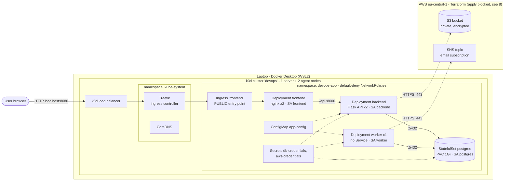

# DevOps on AWS – Rolling Project

A small three-service app (web frontend, API backend, background worker) with
PostgreSQL, S3 and SNS, run on **Kubernetes** with a **Helm chart**
(Task 3) and built and deployed by **Jenkins CI/CD** (Task 4, added below).

| Task | Status | Where |
|---|---|---|
| 1 – App on EC2 | Submitted | – |
| 2 – Terraform + Ansible | Submitted | [`task2-archive/`](task2-archive/) |
| **3 – Kubernetes** | **This README** | `app/`, `helm/`, `k8s/`, `scripts/`, `evidence/task3/` |
| 4 – Jenkins CI/CD | In progress | – |

---

## 1. What the app does

| Component | Technology | Role |
|---|---|---|
| **frontend** | nginx (unprivileged) | The **only** public entry point. Serves the web page and forwards `/api/*` to the backend |
| **backend** | Python Flask + gunicorn | REST API: saves and lists notes in PostgreSQL, uploads files to S3 |
| **worker** | Python | Background loop: every 10 s finds new uploads in the DB and sends an SNS email |
| **postgres** | PostgreSQL 17 | Stores notes and upload records |
| S3 / SNS | AWS (outside the cluster) | File storage and email notifications |

Flow for an upload: `browser → frontend → backend → S3 + DB row → worker sees row → SNS email`.

## 2. Architecture



**Public / internal:** only the Ingress is reachable from outside. All four
Services are `ClusterIP` (internal). The worker has **no Service at all**,
because nothing ever connects to it. Every arrow in the diagram is an
allowed connection; everything else is blocked by NetworkPolicies (section 7.4).

### Inside the cluster vs. outside

| Inside Kubernetes | Outside the cluster |
|---|---|
| frontend, backend, worker, PostgreSQL, Ingress, ConfigMap, Secrets, NetworkPolicies, ServiceAccounts | S3 bucket, SNS topic, IAM user (AWS, created by Terraform in [`terraform/`](terraform/)) |

### Why a local cluster (k3d) instead of EKS
The task allows k3d/kind. EKS would cost roughly $9/day (control plane, nodes,
NAT gateway, load balancer) and the AWS account has no budget left. k3d runs a
real multi-node Kubernetes (k3s) inside Docker, ships an ingress controller
(Traefik), and **enforces NetworkPolicies**. The same Helm chart would run on
EKS by changing values (see Trade-offs).

## 3. Repository layout

```
app/{frontend,backend,worker}/   source code, Dockerfile, .dockerignore per service
helm/devops-app/                 Helm chart: templates/ + values.yaml
k8s/secret.example.yaml          format of the secrets (fake values only)
terraform/                       S3 bucket, SNS topic, least-privilege IAM user
scripts/                         create / deploy / test / scan / evidence / destroy
evidence/task3/                  command outputs proving everything works
task2-archive/                   Task 2, kept for reference
```

### The Helm chart

| Template | Creates |
|---|---|
| `frontend.yaml`, `backend.yaml` | Deployment + ClusterIP Service each |
| `worker.yaml` | Deployment only (no Service) |
| `postgres.yaml` | StatefulSet + PersistentVolumeClaim + Service (toggle: `postgres.enabled`) |
| `configmap.yaml` | `app-config`: non-sensitive settings from `values.yaml` |
| `serviceaccounts.yaml` | One ServiceAccount per component, API token not mounted |
| `ingress.yaml` | Route from the ingress controller to the frontend only |
| `networkpolicies.yaml` | Default-deny + one allow-policy per component |
| `_helpers.tpl` | Shared labels and the image name, so they aren't repeated |

Every Deployment defines: image, replicas, labels, selector, ports, env vars
(ConfigMap + Secrets), resource requests/limits, readiness and liveness probes,
and a restrictive securityContext.

## 4. Prerequisites

| Tool | Version used | Install (Windows, Chocolatey) |
|---|---|---|
| Docker Desktop (WSL2) | 4.96 / engine 29.9 | `choco install docker-desktop` |
| k3d | 5.9.0 (Kubernetes 1.35) | `choco install k3d` |
| kubectl | 1.37 | `choco install kubernetes-cli` |
| Helm | 4.1 | `choco install kubernetes-helm` |
| Trivy | 0.76 | `choco install trivy` |
| Git Bash | – | comes with Git for Windows; **run all scripts in Git Bash** |

## 5. How to run it

```bash
# 1. Create the cluster (1 server + 2 agents, host port 8080 -> ingress)
./scripts/create-cluster.sh

# 2. Commit your code - images are tagged with the commit SHA
git add . && git commit -m "..."

# 3. Build, load, create namespace + secrets, install the chart
./scripts/deploy-local.sh

# 4. Open the app
http://localhost:8080
```

What `deploy-local.sh` does, step by step:

| Step | Command (simplified) | Why |
|---|---|---|
| Tag | `TAG=$(git rev-parse --short HEAD)` | Every image is traceable to exact code; never `latest` |
| Build | `docker build -t devops-app/<svc>:$TAG app/<svc>` | One image per service |
| "Push" | `k3d image import ...` | A local cluster can load images directly instead of pulling from a registry. Task 4 pushes to a real registry (GHCR) |
| Namespace | `kubectl create namespace devops-app` | The app never runs in `default` |
| Secrets | `kubectl create secret generic db-credentials --from-env-file=secrets/db.env` | Values come from gitignored files; a random DB password is generated on first run |
| Deploy | `helm upgrade --install devops-app helm/devops-app -n devops-app --set image.tag=$TAG --wait` | Installs or upgrades in one idempotent command; `--wait` fails if pods don't become ready |

### Creating the secrets manually
The format is in [`k8s/secret.example.yaml`](k8s/secret.example.yaml) (fake values).

```bash
mkdir -p secrets            # gitignored
printf 'DB_USER=app\nDB_PASSWORD=<strong-password>\n' > secrets/db.env
kubectl create secret generic db-credentials -n devops-app --from-env-file=secrets/db.env

# optional - enables S3 + SNS (keys of the IAM user from terraform/)
printf 'AWS_ACCESS_KEY_ID=...\nAWS_SECRET_ACCESS_KEY=...\n' > secrets/aws.env
kubectl create secret generic aws-credentials -n devops-app --from-env-file=secrets/aws.env
```

## 6. How to check that it works

```bash
./scripts/collect-evidence.sh        # regenerates everything in evidence/task3/
./scripts/test-network-policies.sh   # 15 allowed/blocked connection tests
./scripts/scan-images.sh             # Trivy vulnerability scan of all images
```

| Evidence file | Shows |
|---|---|
| [`01-cluster-and-workloads.txt`](evidence/task3/01-cluster-and-workloads.txt) | All `kubectl get` outputs required by the task |
| [`02-describe-pods.txt`](evidence/task3/02-describe-pods.txt), [`03-logs.txt`](evidence/task3/03-logs.txt) | `describe` and `logs` of every component |
| [`04-app-tests.txt`](evidence/task3/04-app-tests.txt) | HTTP through the Ingress, frontend → backend, DB write + read, worker processing an upload |
| [`05-self-healing.txt`](evidence/task3/05-self-healing.txt) | Pods deleted and replaced, app keeps working, data survives a DB restart |
| [`06-security-checks.txt`](evidence/task3/06-security-checks.txt) | Non-root users, read-only filesystem, no API token, dropped capabilities, pinned image tags |
| [`network-policy-tests.txt`](evidence/task3/network-policy-tests.txt) (+ `-BEFORE`) | 15/15 tests pass; before the policies, 7 should-be-blocked connections were open |
| [`image-scans/SUMMARY.md`](evidence/task3/image-scans/SUMMARY.md) | CRITICAL vulnerabilities 18 → 1 (accepted with reasoning) |

## 7. Security

### 7.1 Separation of permissions (ServiceAccounts)
Each component has **its own ServiceAccount** (`frontend`, `backend`, `worker`,
`postgres`) instead of sharing `default`. None of the apps talks to the
Kubernetes API, so:
- **No RBAC Roles or RoleBindings are granted** to any app ServiceAccount – zero
  Kubernetes permissions. No `cluster-admin` anywhere.
- `automountServiceAccountToken: false` – the API token isn't even placed in the pods,
  so a compromised container has no credential to talk to the cluster.

Why not one broad account for everything: if a single component is compromised,
the attacker gets only that component's permissions. With shared, broad
permissions, one weak service exposes the whole system.

AWS permissions are also separate from Kubernetes permissions: only backend and
worker receive the `aws-credentials` Secret; the frontend and Postgres never see it.

### 7.2 RBAC
Not needed for the app (no component calls the Kubernetes API). Task 4 adds
RBAC for Jenkins with minimal, namespace-scoped Roles.

### 7.3 Secrets management
| Question | Answer |
|---|---|
| Where are secrets stored? | In **Kubernetes Secrets** inside the cluster, created from local files in `secrets/` (gitignored) |
| How are they created? | `deploy-local.sh` (generates a random DB password on first run) or the manual commands in section 5 |
| What is in Git? | Only `k8s/secret.example.yaml` with fake values. `.gitignore` also blocks `*.tfstate`, `*.pem`, `.env` |
| What is NOT a secret? | DB host, bucket name, topic ARN, region → ConfigMap `app-config` |
| Only Kubernetes Secrets? | Yes. Limitation: Secrets are base64-encoded, not encrypted, and anyone with read access to Secrets in the namespace can read them. Production improvement: External Secrets Operator + AWS Secrets Manager, or Sealed Secrets, plus etcd encryption at rest |

The AWS access key for S3/SNS is deliberately **not created by Terraform** –
Terraform would store it in plain text in `terraform.tfstate`. It is created with
`aws iam create-access-key` and goes straight into `secrets/aws.env`.

### 7.4 Network security
All pods in `devops-app` start from **default deny** (no traffic in or out).
Allow rules are added per component – a connection works only if a rule allows it.

| From → To | Allowed? | Why |
|---|---|---|
| Internet → Ingress → **frontend** :8080 | ✅ | The single public entry point (only Traefik pods may reach the frontend) |
| frontend → **backend** :8000 | ✅ | nginx forwards `/api` |
| backend, worker → **postgres** :5432 | ✅ | They read/write data |
| backend, worker → internet :443 | ✅ | AWS S3/SNS APIs (HTTPS only, private IP ranges excluded) |
| all pods → CoreDNS :53 | ✅ | Name lookup (`backend`, `postgres`) |
| anything → **worker** | ❌ | The worker accepts no connections at all |
| frontend → postgres | ❌ | The frontend never needs the DB; limits damage if nginx is compromised |
| worker → backend | ❌ | Not needed |
| postgres → anywhere | ❌ | The database never initiates connections |
| pods in other namespaces → any app pod | ❌ | Only the ingress controller may enter |

Exposed outside the cluster: **only the Ingress → frontend**. backend, worker
and postgres have no route from outside. Proof: [`network-policy-tests.txt`](evidence/task3/network-policy-tests.txt).

> **Why this matters:**
> Default deny and blocking frontend → database matter because they create a dead end
> for any hacker: even if they get access to the frontend, they can't crawl into the database.

### 7.5 Container security
Set in every pod (verified in [`06-security-checks.txt`](evidence/task3/06-security-checks.txt)):

```yaml
securityContext:              # pod level
  runAsNonRoot: true
  runAsUser: 10001            # 101 for nginx, 70 for postgres
  seccompProfile: { type: RuntimeDefault }
containers:
  - securityContext:          # container level
      allowPrivilegeEscalation: false
      readOnlyRootFilesystem: true
      capabilities: { drop: ["ALL"] }
```

Writable paths are explicit `emptyDir` volumes only (`/tmp`, nginx's generated
config, Postgres' socket dir) – an attacker can't modify the app or drop files
elsewhere. Every container has CPU/memory **requests and limits**, so one
component can't starve the others.

### 7.6 Image security
| Question | Answer |
|---|---|
| Where do images come from? | Built from our own Dockerfiles in `app/`, on top of official base images (`python`, `nginxinc/nginx-unprivileged`, `postgres`) |
| Fixed tags, no `latest`? | Base images pinned to exact versions; our images tagged with the **git commit SHA** |
| Secrets in images? | None – all config comes from env vars at runtime; `.dockerignore` excludes `.env` and caches |
| Non-root? | Every Dockerfile ends with a non-root `USER` |
| Scanned? | Yes, Trivy ([`image-scans/SUMMARY.md`](evidence/task3/image-scans/SUMMARY.md)): first scan found 18 CRITICAL / 335 HIGH in old base images → updated to patched versions → **1 CRITICAL** left (in an image helper that never runs, see summary). Python dependencies: 0 HIGH/CRITICAL |

### 7.7 Ingress security
| Question | Answer |
|---|---|
| How is the app exposed? | k3d load balancer (host port 8080) → Traefik ingress controller → Ingress `frontend` → frontend Service |
| HTTPS? | Not locally (localhost only, no domain). On EKS: AWS Load Balancer Controller with an ACM certificate, or cert-manager + Let's Encrypt, with HTTP → HTTPS redirect |
| Access restriction? | Only the frontend has a route; the cluster is reachable only from this machine. On a public cloud: source-IP allowlist on the load balancer or a WAF |
| Public vs internal traffic separated? | Yes – public traffic enters only through the Ingress; all Services are internal `ClusterIP`; NetworkPolicies allow the frontend to receive traffic only from the ingress controller |

## 8. AWS: S3 and SNS (blocked)

[`terraform/`](terraform/) creates a private, encrypted **S3 bucket**, an **SNS
topic with email subscription**, and an **IAM user** whose policy allows only
`s3:PutObject`/`s3:GetObject` on `uploads/*` and `sns:Publish` on that one topic.

**Status:** the code is complete and validated (`terraform validate`), but
`terraform apply` is blocked – the AWS account was closed by AWS after the free
credits ran out (outstanding balance under review with AWS billing support).
Until then the app runs with S3/SNS disabled: uploads return a clear
`S3 is not configured` error and the worker logs the email it *would* send
(see [`04-app-tests.txt`](evidence/task3/04-app-tests.txt)). Enabling it needs no
code changes:

```bash
cd terraform && cp terraform.tfvars.example terraform.tfvars   # set alert_email
terraform init && terraform plan && terraform apply
aws iam create-access-key --user-name devops-app-local          # -> secrets/aws.env
# put terraform outputs into helm/devops-app/values.yaml (S3_BUCKET, SNS_TOPIC_ARN)
./scripts/deploy-local.sh
```

**Why an IAM user and not IRSA:** IRSA (IAM Roles for Service Accounts) needs
EKS – AWS trusts the cluster's identity provider and gives each ServiceAccount a
short-lived role. A local cluster has no such trust, so a static access key is
the only option. Disadvantages: the key doesn't expire, must be rotated
manually, and anyone who reads the Secret can use it. Mitigations: the policy
is limited to two actions on two resources, and only backend/worker get it.
On EKS, `backend` and `worker` ServiceAccounts would get separate IRSA roles
and the Secret would disappear.

### Database connection (RDS question in the task)
| Question | Answer |
|---|---|
| Where does the endpoint come from? | `DB_HOST=postgres` in the ConfigMap – the Kubernetes Service name of the in-cluster database |
| How are username/password stored? | Secret `db-credentials` (see 7.3), read by backend, worker and postgres |
| Who may connect? | Only backend and worker pods (NetworkPolicy `postgres`) |
| What restricts access? | NetworkPolicies (the in-cluster equivalent of the Security Groups used for RDS in Task 2) |
| Why not RDS? | Practice setup without AWS budget. In production RDS is better: managed backups, Multi-AZ failover, patching, no container image to maintain. Switching = `postgres.enabled=false` + RDS endpoint in `DB_HOST` + RDS security group allowing the node group |

## 9. Deleting the environment

```bash
./scripts/destroy-local.sh             # remove app, namespace, secrets and DB data
./scripts/destroy-local.sh --cluster   # ...and delete the k3d cluster
cd terraform && terraform destroy      # AWS resources (when the account is active)
```

## 10. Trade-offs and decisions

| Decision | Why | Cost / what production would do |
|---|---|---|
| k3d instead of EKS | Free, real Kubernetes, allowed by the task | No IRSA, no AWS load balancer; same chart would run on EKS with different values |
| PostgreSQL in the cluster | No AWS budget; allowed for practice | RDS: backups, failover, patching |
| Static IAM key for S3/SNS | IRSA impossible outside EKS | Key rotation is manual; IRSA on EKS |
| Kubernetes Secrets only | Simple, no extra components | External Secrets Operator + AWS Secrets Manager |
| HTTP only | Localhost, no domain | TLS via ACM or cert-manager |
| `k3d image import` instead of a registry | No registry needed locally | Task 4 pushes to GHCR |
| Helm instead of plain manifests | One chart for every environment; required by Task 4's CD | Slightly more to learn than plain YAML |
| Schema created by the backend on startup | Simple for a small app | A migration tool (e.g. Alembic) as a separate Job |

## 11. Problems found and fixed

| Problem | Cause | Fix |
|---|---|---|
| Frontend pod in `CrashLoopBackOff` after a cluster restart | nginx resolved `backend` only once at startup, before cluster DNS was ready | nginx now resolves the name per request (`resolver` + variable); reproduced by switching DNS off – nginx now starts and recovers by itself |
| `kubectl` showed "No resources found" | Docker Desktop's built-in Kubernetes switched the active context | `kubectl config use-context k3d-devops`; disabled Docker Desktop Kubernetes |
| Network test reported a false pass | Test pod from the previous run was still being deleted, so "blocked" really meant "pod missing" | Script waits for cleanup and adds a control check that the test pod is alive |
| Scan script stopped on a clean image | `grep` returns an error code when nothing matches, and `set -e` aborted | `grep -c ... \|\| true` |
| 18 CRITICAL vulnerabilities | Base images pinned a year earlier | Updated to the latest patch versions of the same release lines |
| Scripts could break on Linux | Windows line endings (CRLF) | `.gitattributes` forces LF |

> **Most useful lesson:**
> I learned that the order things start in matters. After the cluster restarted, the
> frontend crashed because it started before DNS was ready and couldn't find the backend.
> Making nginx look up the backend on every request fixed it, so now the frontend
> recovers by itself.

## 12. Division of work
Individual project – all work by the author (AI assistance used, as the course recommends).
